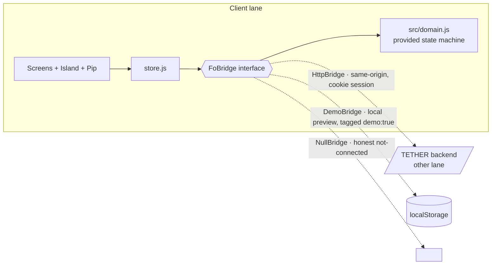
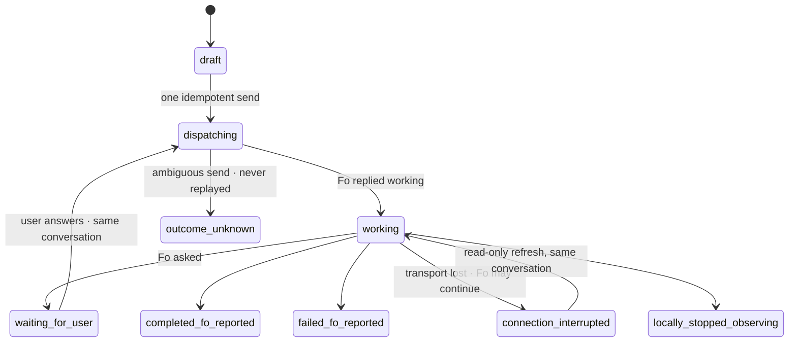

# tether — client lane

The responsive web/PWA companion for Fo work: presence, honest state,
recovery. Unofficial third-party hackathon project; not affiliated with
or endorsed by Wajo.

## What this is

- A hand-crafted, dependency-free ES-module app shell (no build step,
  no framework, no UI kit) served statically.
- Installable PWA: `manifest.webmanifest` + `sw.js` + bundled icons.
- The **Tether Island**: a persistent in-app presence pill that expands
  on real run activity with the honest primary action. It is web UI,
  not a native iOS Live Activity — no native capability is claimed.
- **Pip**, an original character (SVG + CSS, state-driven) with static
  fallbacks in `public/assets/pip/`.
- An **evidence view** that separates what Fo reported from what TETHER
  observed, and never claims independent verification.

## Architecture



The client never invents state. Every render derives from the provided
`src/domain.js` state machine, which this lane treats as an unmodified
contract (`node --test src/domain.test.js` — 17 tests).



Key rules the UI enforces visibly:

- **One dispatch, never replayed.** A reload mid-dispatch restores as
  `outcome_unknown`; the recovery copy says so and offers discard, not
  retry.
- **Resume is read-only.** "Resume observing" refreshes the same
  `conversationId`. It never sends a new task.
- **Terminal outcomes are labeled "Fo-reported; not independently
  verified."** The evidence panel separates *Fo reported* (status +
  words) from *TETHER observed* (timestamps, transitions, dispatch
  count, poll count) and shows an honest empty "Independently verified"
  column.
- **Preview is labeled.** Demo runs carry `demo:true`; every card and
  the header say "preview". Nothing simulated is ever presented as
  live Fo activity.

## Lanes and files

| Path | Owns |
|---|---|
| `src/domain.js`, `src/domain.test.js` | provided contract — **do not edit** |
| `src/client/**` | this lane: UI, Pip, island, bridges, tests |
| `public/assets/pip/**` | this lane: static mascot fallbacks |
| server, persistence, Fo OAuth | other lane — see `state/bridge.js` `HttpBridge` for the expected API (mirrors directive §10.8) |

## Run it

```sh
# from the repo root — no install, no build
python3 -m http.server 8410
# open http://localhost:8410/src/client/index.html          → honest not-connected shell
# open http://localhost:8410/src/client/index.html?demo=1   → labeled local lifecycle preview
```

## Checks

```sh
src/client/scripts/check.sh
```

1. parses every client JS/MJS file;
2. runs the provided domain contract tests (17);
3. runs this lane's tests (7): lifecycle, same-conversation answer,
   read-only resume, reload recovery (mid-dispatch → `outcome_unknown`;
   mid-work → `connection_interrupted`), honest label coverage,
   mascot-state derivation;
4. verifies every referenced static asset exists.

## Design system

Tokens in `styles/tokens.css`. Type: Bricolage Grotesque (display),
Hanken Grotesk (UI), Space Mono (data) — self-hosted variable/subset
woff2 in `assets/fonts/`. Glass follows a strict hierarchy
(`styles/glass.css`): the island, switch thumbs and small capsules only;
all text lives on solid surfaces. The interface remains legible with
glass fully disabled (verified in headless Chromium without
`backdrop-filter`). `prefers-reduced-motion` and a user "Keep Pip still"
setting stop all loops; every state also appears as text.

## Honest limitations

- No live Fo call has been made from this lane; `HttpBridge` is written
  against the documented contract but untested until the backend lands.
- The island is an in-app web component, not native OS UI.
- PWA installability verified via manifest + service worker presence;
  install prompts not exercised on a physical device.
- QA: headless Chromium at 390×844, 834×1112, 1440×900. Firefox,
  Safari/WebKit, and physical devices not yet tested.
- Pip is SVG/CSS, not the Blender GLB the directive prefers; static
  fallbacks are PNG renders of the same character.

## Backend integration (real TETHER API)

`state/bridge.js` `HttpBridge` implements the real local API contract: `GET /api/health`, `GET/POST /api/runs` (idempotency key required), `GET /api/runs/:id`, `POST /api/runs/:id/reply|refresh|stop`, `GET /api/runs/:id/timeline`. Delete is intentionally absent: backend history is durable, so removal controls only appear on preview runs.

Two dev-only harness scripts (never shipped behavior):
- `node src/client/scripts/dev-fake-backend.mjs` — the real API with a scripted fake Fo adapter. No Fo traffic; every fake reply is marked `[simulated Fo]`.
- `node src/client/scripts/dev-proxy.mjs` — static server + same-origin `/api` proxy (the API requires Origin == Host on writes).

Verified end to end with the fake adapter: create, waiting-for-user, answer, completed (Fo-reported), replay, reload recovery. Run timelines render server events with evidence-kind labels (Fo-reported / TETHER observed / You) and Fo text as plain text.
